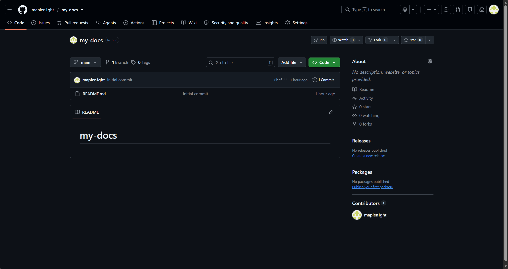
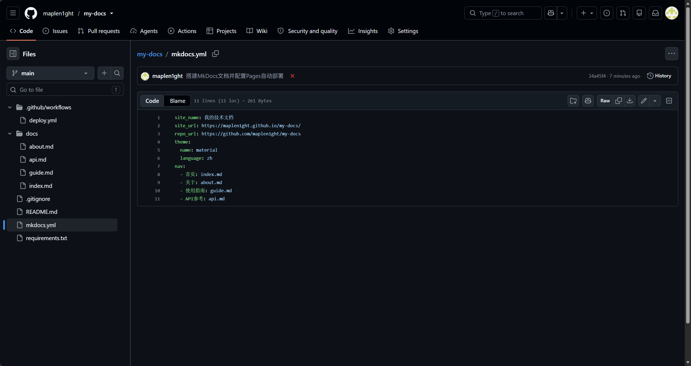
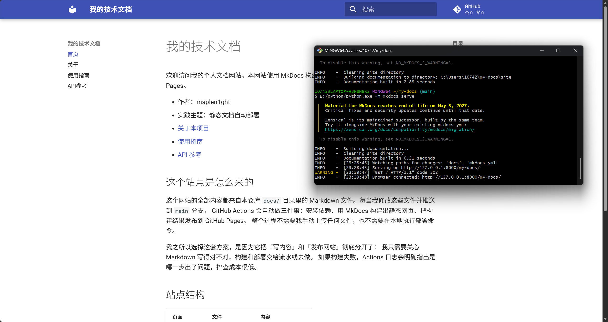
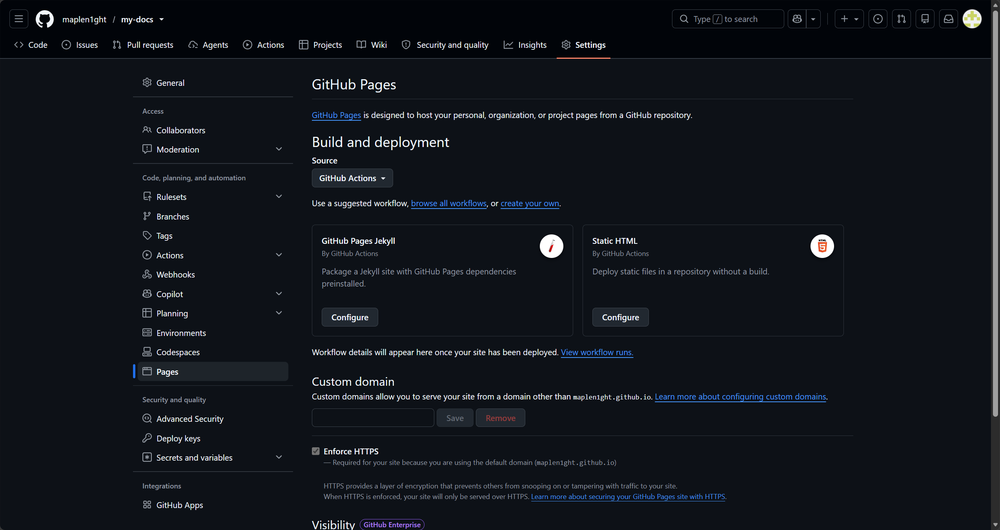
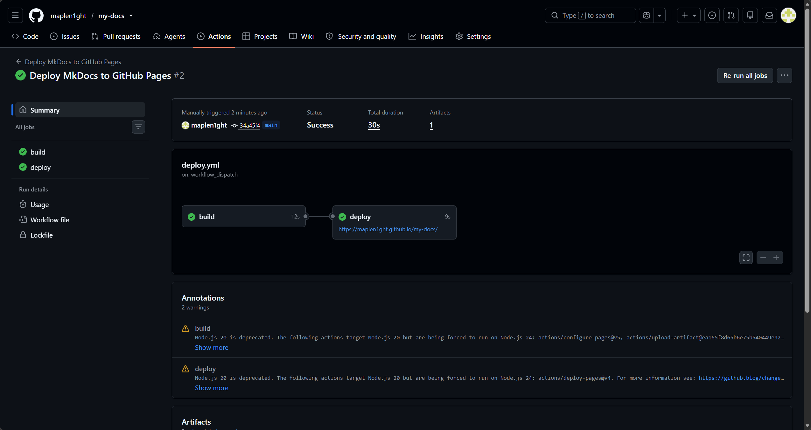
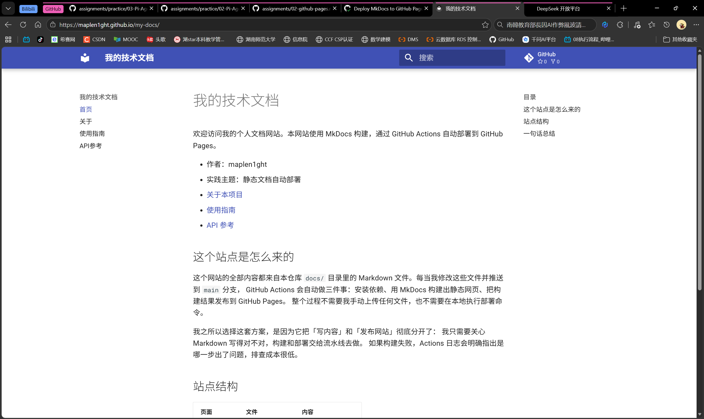
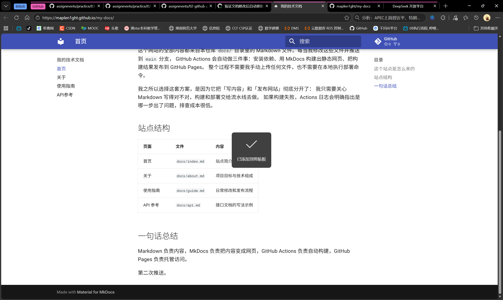

# 实践项目2：个人实验报告

## 1. 基本信息

- GitHub 登录名：maplen1ght
- 个人仓库地址：https://github.com/maplen1ght/my-docs
- 最终网站地址：https://maplen1ght.github.io/my-docs/

## 2. 实践过程与关键截图

### 2.1 仓库创建

在 GitHub 上用本人账号创建公开仓库 `my-docs`，勾选初始化 README，默认分支为 `main`。
克隆到本地后确认当前分支：

```bash
git clone https://github.com/maplen1ght/my-docs.git
cd my-docs
git branch --show-current   # 输出 main
```



截图能看到仓库所有者 `maplen1ght`、仓库名 `my-docs`，标题旁有 `Public` 标识，说明是公开仓库，符合本次个人作业要求。

### 2.2 项目结构与 MkDocs 配置

在仓库根目录建立如下结构：

```text
my-docs/
├── .github/workflows/deploy.yml
├── docs/
│   ├── index.md
│   ├── about.md
│   ├── guide.md
│   └── api.md
├── report/
│   ├── README.md
│   └── images/
├── mkdocs.yml
├── requirements.txt
├── .gitignore
└── README.md
```

`mkdocs.yml` 内容如下，其中账号和仓库名已替换成本人信息：



三个关键概念的职责划分：

- **`docs/`**：存放网站的全部内容源码，也就是我手写的四个 Markdown 文件。它是唯一需要我维护的部分，提交到仓库。
- **`nav`**：定义导航栏的顺序和显示名称。注意其中的路径是**相对于 `docs/` 目录**的，所以写 `index.md` 而不是 `docs/index.md`，写错会导致构建失败。
- **`site/`**：MkDocs 构建后生成的静态网站产物，属于一次性输出，不含任何手写内容。因为每次构建都会整体覆盖，手工修改毫无意义，所以写进 `.gitignore` 排除在版本控制之外。

另外 `requirements.txt` 限定依赖版本范围（`mkdocs>=1.6,<2`、`mkdocs-material>=9.6,<10`），只锁主版本，避免 2.0 这类破坏性升级。

### 2.3 本地构建或预览

在本地安装依赖后执行严格构建和预览：

```bash
python -m pip install -r requirements.txt
python -m mkdocs build --strict
python -m mkdocs serve
```



终端中可以看到 `Documentation built in 2.88 seconds`，`--strict` 没有报警告，说明没有死链和配置错误。
随后 `serve` 启动，输出 `Serving on http://127.0.0.1:8000/my-docs/`，浏览器打开后依次检查了四个页面：

- 首页：表格正常显示，页面内三个跳转链接可点
- 关于：技术组成表格正常
- 使用指南：代码块有语法高亮
- API 参考：`bash` 与 `json` 代码块正常，两张表格显示完整

检查完毕按 `Ctrl+C` 停止预览。

### 2.4 Pages 设置

在仓库 `Settings` → `Pages` → `Build and deployment` → `Source` 中选择 **GitHub Actions**。



这一步是本次部署能否成功的前提。按课程要求统一使用官方 Pages Actions 工作流，**没有**选择 "Deploy from a branch"，因此不需要 `gh-pages` 分支，也不需要开启创建 / 批准 PR 的权限。

同时在 `Settings` → `Actions` → `General` 中确认仓库允许使用工作流中的 Actions（保持默认的 "Allow all actions and reusable workflows"），以及默认的只读 Workflow permissions，未额外提权。

### 2.5 Actions 首次构建和部署

推送代码后第一次运行失败，失败位置是 `Configure Pages` 这一步。原因是当时还没把 Pages 的发布来源设为 GitHub Actions，`actions/configure-pages@v5` 找不到 Pages 配置（查询 Pages 接口返回 404），因此直接报错，后续的安装依赖、构建、上传全部被跳过，`deploy` 因 `needs: build` 未满足而跳过。

完成 2.4 的设置后重新运行，`build` 与 `deploy` 均成功：



- `build` 耗时 12 秒：检出源码 → 配置 Python 3.12 → 安装依赖 → `mkdocs build --strict` → 上传 `site/` 产物
- `deploy` 耗时 9 秒：把产物发布到 GitHub Pages，环境为 `github-pages`
- 运行页面显示部署地址 `https://maplen1ght.github.io/my-docs/`

运行记录里出现了两条 `Node.js 20 is deprecated` 的 warning（涉及 `actions/configure-pages@v5`、`actions/upload-artifact`、`actions/deploy-pages@v4`）。这是 GitHub 平台推进 Node 24 的提示，不影响本次构建和部署结果。

对应运行链接：https://github.com/maplen1ght/my-docs/actions/runs/45039337772

### 2.6 网站访问与四页导航检查

打开 https://maplen1ght.github.io/my-docs/ ，逐页检查四个页面：



检查结果：

| 页面 | 地址 | 结果 |
| --- | --- | --- |
| 首页 | `/my-docs/` | 正常，表格与页内链接可用 |
| 关于 | `/my-docs/about/` | 正常，技术组成表格完整 |
| 使用指南 | `/my-docs/guide/` | 正常，代码块高亮 |
| API 参考 | `/my-docs/api/` | 正常，表格与 JSON 代码块完整 |

四页导航均可正常切换，左侧导航栏四个条目齐全，右侧目录能跟随标题生成，页面间链接跳转正常，样式资源（Material 主题、搜索框、GitHub 图标）加载完整，中文无乱码。地址栏保留了 `https://maplen1ght.github.io/my-docs/`，说明访问的是项目站点而非用户主页，必须带仓库路径这一点也确认了。

### 2.7 第二次推送与自动更新验证

在 `docs/index.md` 末尾追加一句本人编写的文字：

```markdown
第二次推送。
```

提交并推送：

```bash
git add docs/index.md
git commit -m "验证文档修改后自动更新网站"
git push origin main
```

这次**没有点击手动部署**，而是观察 push 自动触发了新的运行。运行记录里 Event 显示为 `push`，提交为 `7fcc240`，`build` 与 `deploy` 均成功，随后刷新网站，首页底部出现了新增的那句话：



- 对应提交链接：https://github.com/maplen1ght/my-docs/commit/7fcc2404c586741945dad65eb3f7d19c51cba99f
- 对应 Actions 运行链接：https://github.com/maplen1ght/my-docs/actions/runs/45040561417

这证明「修改文档 → 推送 → 自动构建 → 网站更新」这条链路是通的，不需要任何人工干预。第一次刷新时若看不到新增内容，需要强制刷新（`Ctrl+F5`）排除浏览器缓存。

## 3. 问题与解决

### 3.1 Pages 未启用导致首次部署失败

- **现象**：推送后 Actions 运行失败，`build` 任务在第 4 步 `Configure Pages` 报错，后续步骤全部 skipped，`deploy` 显示为跳过。
- **关键日志**：失败集中在 `Configure Pages`，前面 `Checkout source`、`Set up Python` 均成功。
- **原因**：仓库的 Pages 从未启用，发布来源也不是 GitHub Actions，`actions/configure-pages@v5` 拿不到 Pages 站点信息，因此直接失败。
- **解决**：到 `Settings` → `Pages` 把 Source 改为 GitHub Actions，再到 Actions 页面手动 `Run workflow` 重跑，`build` 与 `deploy` 全部通过。

### 3.2 本地创建虚拟环境失败（WinError 5）

- **现象**：执行 `python -m venv .venv` 报 `Error: [WinError 5] 拒绝访问。: 'C:\\Users\\10742\\my-docs\\.venv'`，换到 `D:\venvs\my-docs` 同样报 `[WinError 5] 拒绝访问。: 'D:\\venvs'`。
- **排查过程**：先确认目录权限正常（当前用户对该目录有 FullControl），再测试同目录下 `touch _test.txt` 可以正常创建文件，说明目录本身可写；但用 Python 直接写文件时报 `PermissionError: [Errno 13] Permission denied`，即拦截是按可执行程序进行的。
- **原因**：本机安全软件对特定 Python 解释器的写盘行为做了拦截，与目录权限、磁盘空间、Python 版本都无关。
- **解决**：改用本机另一套完整安装的 Python（`E:\python`，版本 3.14.3）来执行后续命令，该解释器写盘不受影响，依赖安装成功。

### 3.3 pip 报 "No usable temporary directory"

- **现象**：`python -m pip install -r requirements.txt` 长时间无输出，加 `-v` 后直接抛异常，提示在 `%LOCALAPPDATA%\Temp`、`C:\WINDOWS\Temp`、`c:\temp`、`c:\tmp`、`\temp`、`\tmp`、项目目录等 9 个候选里都找不到可用的临时目录。
- **原因**：和 3.2 同源——该解释器无法在用户目录下创建文件，导致 `tempfile.mkdtemp()` 全部失败，pip 连下载都还没开始就退出了。
- **解决**：换成 3.14 的解释器后该问题消失，依赖正常安装，`mkdocs build --strict` 通过。

### 3.4 git push 报 "Recv failure: Connection was reset"

- **现象**：`git push origin main` 报 `fatal: unable to access 'https://github.com/maplen1ght/my-docs.git/': Recv failure: Connection was reset`。
- **排查过程**：检查发现 `git config` 里 `http.proxy`、`https.proxy` 均为空，而 Windows 系统代理处于开启状态（`ProxyEnable=1`，`ProxyServer=127.0.0.1:7892`）。git 默认不读取系统代理，因此浏览器能打开 GitHub，git 却是直连并被重置。
- **解决**：为 git 显式配置代理后推送成功：

```bash
git config --global http.proxy http://127.0.0.1:7892
git config --global https.proxy http://127.0.0.1:7892
git push origin main
```

- **遗留问题**：该配置是全局的，若代理服务未运行则 git 会连不上，需要用 `git config --global --unset http.proxy`（以及 `https.proxy`）清除，或改用 `git -c http.proxy=... push` 临时指定。

### 3.5 后续核对过的日志与配置

除上述实际报错外，还主动核对了以下内容，均确认无误：

- `.gitignore` 中 `site/`、`.venv/`、`__pycache__/` 生效，`git status` 里从未出现构建产物或虚拟环境目录
- 远程仓库文件树只包含源码与配置共 9 个文件，没有误提交 `site/`
- 工作流中 `${{ steps.deployment.outputs.page_url }}` 等表达式原样保留，未被替换成具体账号
- `mkdocs.yml` 的 `nav` 路径均为相对 `docs/` 的写法
- YAML 全部使用空格缩进，无 Tab

## 4. 原理理解

**1. `docs/` 和 `site/` 各保存什么？为什么不用手工修改 `site/`？**

`docs/` 保存的是**源码**，即我手写的 Markdown 文本，它是唯一需要人工编辑和维护的内容。
`site/` 保存的是**构建产物**，是 MkDocs 读取 `docs/` 与 `mkdocs.yml` 后生成的一整套静态文件（HTML、CSS、JS、搜索索引等）。
不需要、也不应该手工修改 `site/`，因为它是完全由源码推导出来的中间结果：只要源码或配置发生变化，下一次 `mkdocs build` 就会把整个目录重新生成并覆盖，任何手改都会丢失。把它写进 `.gitignore` 排除出版本控制，也是同样的道理——它可随时再生成，提交它只会让仓库里塞满重复内容，还会在合并时产生大量无意义冲突。

**2. 本次工作流在什么情况下自动运行？**

由 `deploy.yml` 的 `on` 段决定，有两种触发方式：

- `push` 到 `main` 分支，且改动命中 `paths` 过滤列表中的任意一项：`docs/**`、`mkdocs.yml`、`requirements.txt`、`.github/workflows/deploy.yml`。
- `workflow_dispatch`：手动触发，供首次运行和排错重试使用。

也就是说，只要改的是文档内容或构建相关的配置，推送后就会自动构建部署；而只改 `README.md`、`report/` 这类与站点构建无关的文件，不会触发。

**3. `build` 与 `deploy` 两个任务有什么区别？**

`build` 是**构建任务**：在干净的 `ubuntu-latest` 上检出源码、配置 Python 3.12、`pip install -r requirements.txt`、执行 `mkdocs build --strict` 生成 `site/`，最后用 `actions/upload-pages-artifact@v4` 把 `site/` 打包成部署产物（artifact）上传。它只拥有 `contents: read`，不接触线上环境。

`deploy` 是**发布任务**：通过 `needs: build` 声明依赖，只有 build 成功才会执行；它不重新构建，而是下载上一步的 artifact，交给 `actions/deploy-pages@v4` 发布到 `github-pages` 环境，并把 `page_url` 作为输出回传。它单独声明了 `pages: write` 和 `id-token: write` 权限，这正是官方 Pages 部署所需的 OIDC 授权。

拆成两个 job 的好处是职责与权限分离：构建阶段只需要读源码，发布阶段才拿到写 Pages 的权限，即使构建脚本出问题也无法直接影响线上站点。

**4. 只修改 `report/README.md` 会触发部署吗？为什么？**

不会。`report/` 不在 `paths` 白名单里（只有 `docs/**`、`mkdocs.yml`、`requirements.txt`、`.github/workflows/deploy.yml`），push 事件不会匹配过滤条件，工作流根本不会启动。

这是刻意设计的结果：报告、README 这类文件不参与站点构建，`mkdocs build` 完全不读取它们，即使触发部署，生成的 `site/` 也与上一次完全相同，属于纯粹浪费运行时间。我第一次补充报告后推送，Actions 页面确实没有出现新的运行记录，与预期一致。

**5. 本次方案为何无需创建 `gh-pages` 分支？**

传统做法是让 `deploy` 把构建产物 push 到 `gh-pages` 分支，再把这个分支设为 Pages 的发布源。这条路径需要仓库的写权限、需要额外维护一个长期存在的产物分支，还要处理分支保护和推送冲突。

本次使用的是 GitHub 官方的 Pages 工作流：`actions/upload-pages-artifact@v4` 把 `site/` 上传为一次性的 Actions artifact，`actions/deploy-pages@v4` 再通过 Pages 部署接口直接发布，中间产物由 GitHub 托管，不落地成任何分支。同时 `permissions` 只在 `deploy` 任务里声明 `pages: write` 和 `id-token: write`，靠 OIDC 令牌完成授权，因此既不需要 `gh-pages` 分支，也不需要开启 "Allow GitHub Actions to create and approve pull requests"，更不需要自行申请或填写访问令牌。产物本身是临时的，反而比长期存在的分支更干净。
